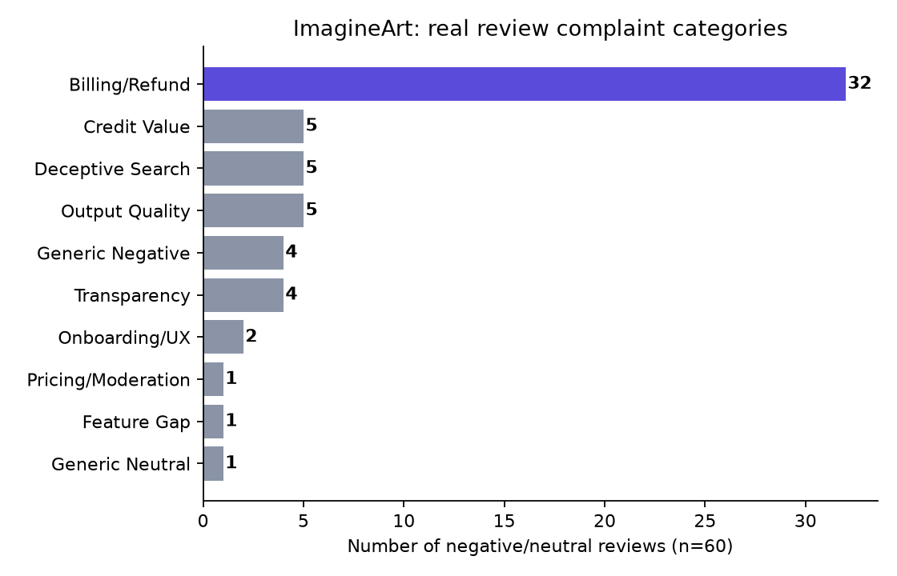

# ImagineArt Checkout & Cancellation Clarity — A Product Case Study

**TL;DR:** I analyzed 100 public Trustpilot reviews of ImagineArt (a generative-AI creative platform) and found that over half of the negative ones, 53.3%, are about one fixable problem: people don't understand what they're being charged, or how to cancel. This repo contains the analysis, a product requirements document (PRD) for a fix, a proposed A/B test to validate it, and the code used to collect and analyze the data.

> This is an independent, self-directed practice project. It is **not affiliated with ImagineArt or its parent company, Vyro**, and it uses **no internal ImagineArt data**, only reviews anyone can read on Trustpilot.

---

## How this was built (please read)

I built this project with **Claude (Anthropic's AI assistant)** as my working partner, and I'm saying so up front:

- **Claude helped write** the Python scripts, the first-pass review categories, the charts, and drafts of the PRD, hypothesis, and experiment design.
- **I directed the project**: I chose the company and the problem space, decided the scope, ran every script on my own machine, collected the Trustpilot pages myself, and reviewed the outputs.
- **The data is real and checkable.** The raw pages and the full categorized dataset are in this repo, so anyone can re-count the categories and challenge my labels.

I'm applying for Associate Product Manager / Growth roles, and the job descriptions ask for people who use AI to make research, analysis, and reporting faster. This project is also an example of working that way.

---

## Why I built this

I wanted to show, not just claim, that I can follow the loop a product or growth team follows: find a real problem in real evidence, write a testable hypothesis, define success metrics, and design a way to check whether a fix works.

---

## The result

Of 100 reviews, 60 were negative or neutral (3 stars or below). Each was assigned to one category based on its text.



**32 of the 60 (53.3%) are billing or cancellation complaints.** The next-largest categories (Credit Value, Deceptive Search, Output Quality) have 5 each, so billing is about six times larger than any other.

Those 32 complaints break into five sub-problems:

| Sub-problem | Fixable by a product change? |
|---|---|
| A cheap trial converts to a full charge | Yes |
| Monthly vs. annual billing unclear at checkout | Yes |
| No clear way to cancel | Yes |
| Refund requests refused | No, policy and support issue |
| "Unlimited" plans that turn out not to be unlimited | No, marketing and legal issue |

**Conclusion:** the problem looks like **clarity at checkout and cancellation**, not refund generosity. A direct competitor (OpenArt) has a stricter refund policy and its users report similar complaints. The PRD therefore proposes a fix only for the three product-fixable sub-problems: a clear price-and-frequency line at checkout and a separate "Cancel Subscription" option.

Full detail is in `problem and hypothesis.md`.

---

## The process

1. **Collected the data.** Trustpilot blocked my automated request (`scrape reviews.py` returned a 403 error). I saved five review pages from my browser (`page1.html` to `page5.html`) and extracted the reviews with `parse saved html.py` (BeautifulSoup). The extraction is automated, but the page download was manual.
2. **Categorized the reviews.** `categorize reviews.py` made a keyword-based first guess. Final categories were then assigned with Claude's help, using the full text of each review. The result is in `categorized_reviews.csv`.
3. **Counted and charted** the pattern with `analyze.py`.
4. **Checked a competitor** (OpenArt's public refund policy) to test whether the problem is policy or clarity.
5. **Wrote a hypothesis**: if checkout clearly shows price and billing frequency, and a separate Cancel Subscription option exists, billing complaints tied to those three sub-problems will decrease.
6. **Wrote a PRD** with a primary metric, guardrail metrics, user stories, non-goals, and open questions.
7. **Designed an A/B test** and wrote the sample-size and significance code (`ab test sample size.py`).
8. **Mapped the wider growth funnel** (acquisition, activation, retention, referral) in `Funnel Opportunity.md`, grading each opportunity by how strong the evidence is.

---

## What this project is, and isn't

**Real:**
- The review data and the counts behind the 53.3% figure
- The competitor policy comparison, from public pages
- The hypothesis, PRD, and experiment design
- Code that runs end to end

**Not real, or not done:**
- **The A/B test was not run.** It is a design. I have no access to ImagineArt's production systems or users.
- **The 3% baseline used in the sample-size calculation is an assumption.** The resulting figure (about 11,450 users per group) would change with ImagineArt's real ticket rate.
- **No fix was built or shipped**, and no real experiment results exist.

## Limitations

- **Small sample:** 100 reviews, the most recent ones from a single site (Trustpilot). It shows a clear direction but is not a precise measure of all ImagineArt customers.
- **Review bias:** people who write reviews skew toward strong feelings, and billing disputes are a common reason to write one.
- **Judgment-based labels:** each review was put in one category, but some mention several issues. Other reviewers might label a few differently, so the dataset is included for checking.
- **Metric caveat:** total billing tickets also include refund refusals and "unlimited" disputes, which the proposed fix doesn't address. A real test would tag tickets by reason and track the three fixable categories separately.

## What I'd do next with real access

1. Get the actual billing-ticket volume and reasons, and replace the assumed 3% baseline.
2. Confirm whether "Delete Account" already cancels billing, since reviews disagree.
3. Check how subscriptions are handled on iOS, where Apple controls the cancellation screen.
4. Run the test with the guardrails defined in `PRD.md`.

---

## What's in this repo

| File | What it is |
|---|---|
| `problem and hypothesis.md` | The evidence, the 5 sub-problems, the hypothesis, the competitor check |
| `PRD.md` | The product requirements document |
| `Experiment Design.md` | Proposed A/B test: metrics, sample size, decision rules |
| `Funnel Opportunity.md` | Growth opportunities across the funnel, graded by evidence |
| `chart_complaint_categories.png` | The chart above |
| `categorized_reviews.csv` | The categorized dataset behind every number |
| `raw_reviews.csv` | The extracted reviews before categorization |
| `page1.html` – `page5.html` | The saved Trustpilot pages used as the source |
| `scrape reviews.py` | Automated scraper (blocked by Trustpilot with a 403 error) |
| `parse saved html.py` | Parser that reads the saved pages |
| `categorize reviews.py` | Keyword-based first-pass categorizer |
| `analyze.py` | Counts the categories and draws the chart |
| `ab test sample size.py` | Sample-size and significance-test calculations |

**If you read one file, read `PRD.md`.**

## Run it yourself

```
pip install requests beautifulsoup4 pandas matplotlib scipy
python "parse saved html.py"
python "categorize reviews.py"
python analyze.py
python "ab test sample size.py"
```

## Tech stack

Python (`beautifulsoup4`, `pandas`, `matplotlib`, `scipy`; `requests` in the blocked scraper) · Markdown · Git/GitHub · Claude for AI-assisted coding, categorization, and drafting

## Skills demonstrated

Defining a problem from messy qualitative data · hypothesis writing · PRD authorship (metrics, guardrails, user stories, scope, open questions) · A/B test design (sample size, significance) · growth-funnel thinking · working with AI tools while being transparent about what they did

---

Built by **Mairaj Fatima** · [GitHub](https://github.com/mairajfatima) · [LinkedIn](https://linkedin.com/in/mairaj-fatima-62207a310)

Feedback welcome. If you work in product, growth, or billing UX and see something I've missed, please open an issue.
